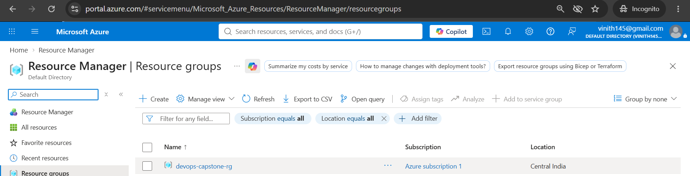
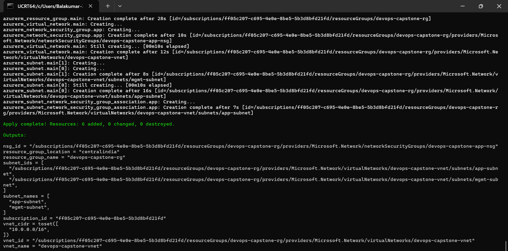
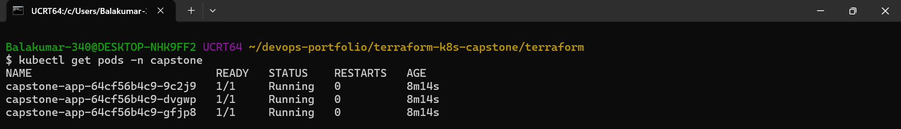
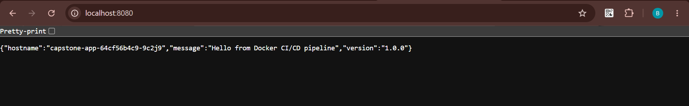
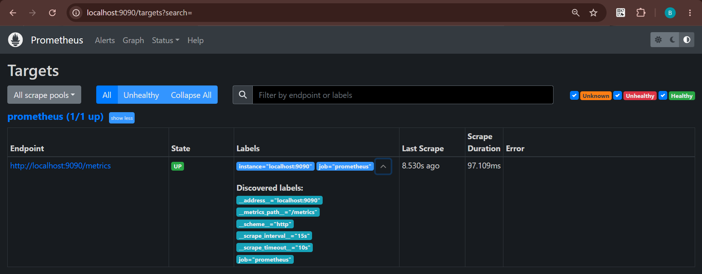
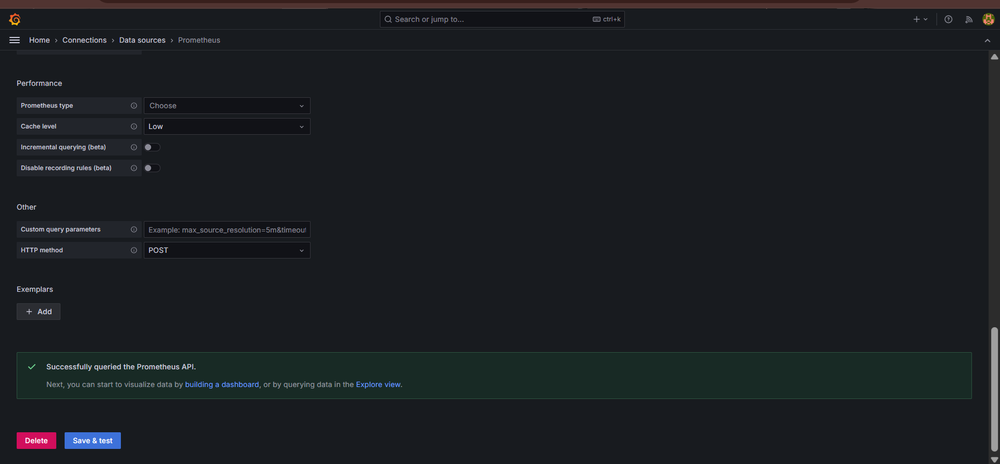

# Terraform + Kubernetes DevOps Capstone

An end-to-end DevOps capstone demonstrating real infrastructure provisioning with **Terraform on Azure**, container orchestration with **Kubernetes**, and full observability with **Prometheus + Grafana**.


## Overview

This capstone project brings together the entire DevOps toolchain in one workflow:

1. **Infrastructure as Code** — Terraform provisions a production-style Azure Virtual Network with subnets, NSG rules, and a resource group.
2. **Container Orchestration** — A Flask application (from the [docker-cicd-pipeline](https://github.com/Vinith145/docker-cicd-pipeline) project) is deployed to Kubernetes with 3 replicas, health probes, resource limits, and a NodePort service.
3. **Observability** — Prometheus scrapes metrics, and Grafana visualizes them with a provisioned datasource and dashboards.

## Architecture

```
                    +-------------------------+
                    |    Azure Cloud          |
                    |                         |
                    |   Resource Group        |
                    |   devops-capstone-rg    |
                    |          |              |
                    |   Virtual Network       |
                    |   10.0.0.0/16           |
                    |     |             |     |
                    |   app-subnet    mgmt-subnet
                    |   10.0.1.0/24   10.0.2.0/24
                    |     |                   |
                    |   Network Security Group
                    |   (SSH, HTTP, HTTPS, 5000)
                    +-------------------------+
                              ^
                              |
                    provisioned by Terraform
                              |
                              |
                    +-------------------------+
                    |    Local Kubernetes     |
                    |    (Minikube)           |
                    |                         |
                    |   Namespace: capstone   |
                    |                         |
                    |   +-----------------+   |
                    |   |  capstone-app   |   |
                    |   |  (3 replicas)   |   |
                    |   +--------+--------+   |
                    |            |            |
                    |            |            |
                    |   +--------v--------+   |
                    |   |  NodePort       |   |
                    |   |  Service :30080 |   |
                    |   +-----------------+   |
                    |                         |
                    |   +-----------------+   |
                    |   |  Prometheus     |   |
                    |   |  :30090         |   |
                    |   +--------+--------+   |
                    |            |            |
                    |   +--------v--------+   |
                    |   |  Grafana        |   |
                    |   |  :30030         |   |
                    |   +-----------------+   |
                    +-------------------------+
```

## Tech Stack

| Layer | Tools |
|-------|-------|
| IaC | Terraform 1.6+, azurerm provider 4.x |
| Cloud | Microsoft Azure (centralindia region) |
| Container Runtime | Docker |
| Orchestration | Kubernetes (Minikube v1.39, K8s 1.37) |
| Application | Python 3.11, Flask 3.0 |
| Monitoring | Prometheus v2.54, Grafana v11.2 |
| CLI Tools | kubectl, az CLI, terraform CLI |

## Features

### Infrastructure (Terraform)
- Azure Resource Group with tags
- Virtual Network (10.0.0.0/16) with 2 subnets
- Network Security Group with 4 ingress rules (HTTP, HTTPS, app port, SSH)
- Fully parameterized with `variables.tf` and `outputs.tf`
- Idempotent — safe to re-apply

### Kubernetes Deployment
- 3 replicas for high availability
- Liveness + readiness probes on `/health`
- Resource requests/limits for CPU and memory
- ConfigMap for environment variables
- NodePort service for external access
- Proper namespace isolation (`capstone`)

### Monitoring
- Prometheus deployment with RBAC (ClusterRole + ServiceAccount)
- Kubernetes service discovery config
- Grafana provisioned with Prometheus datasource via ConfigMap
- Secure by default (sign-up disabled, custom admin password)

## Project Structure

```
terraform-k8s-capstone/
├── README.md
├── LICENSE
├── .gitignore
├── terraform/
│   ├── main.tf                    # Azure infra: RG, VNet, Subnets, NSG
│   ├── variables.tf               # Input variables
│   ├── outputs.tf                 # Output values
│   └── terraform.tfvars.example   # Example overrides
├── k8s/
│   ├── namespace.yaml             # capstone namespace
│   ├── configmap.yaml             # App config
│   ├── deployment.yaml            # 3-replica Flask deployment
│   └── service.yaml               # NodePort service
├── monitoring/
│   ├── prometheus.yaml            # Prometheus Deployment + RBAC + ConfigMap
│   ├── grafana.yaml               # Grafana Deployment + Datasource ConfigMap
│   └── README.md                  # Monitoring docs
├── scripts/
│   ├── deploy.sh                  # Apply all manifests
│   └── cleanup.sh                 # Tear down
├── screenshots/
└── docs/
```

## Prerequisites

- [Terraform](https://developer.hashicorp.com/terraform/install) >= 1.5
- [Azure CLI](https://learn.microsoft.com/cli/azure/install-azure-cli) (`az`)
- [Docker Desktop](https://www.docker.com/products/docker-desktop/)
- [Minikube](https://minikube.sigs.k8s.io/docs/start/) >= 1.30
- [kubectl](https://kubernetes.io/docs/tasks/tools/)
- An Azure subscription

## Setup

### 1. Clone the repo

```bash
git clone https://github.com/Vinith145/terraform-k8s-capstone.git
cd terraform-k8s-capstone
```

### 2. Authenticate with Azure

```bash
az login
az account set --subscription "YOUR-SUBSCRIPTION-ID"
```

### 3. Configure Terraform variables

```bash
cd terraform
cp terraform.tfvars.example terraform.tfvars
# Edit terraform.tfvars and set your subscription_id
```

### 4. Provision infrastructure

```bash
terraform init
terraform plan
terraform apply
```

### 5. Deploy to Kubernetes

```bash
# From project root
minikube start --driver=docker --cpus=2 --memory=4096

# Build and load the app image (from docker-cicd-pipeline project)
cd ../docker-cicd-pipeline
docker build -t docker-cicd-pipeline:latest .
minikube image load docker-cicd-pipeline:latest

# Back to capstone
cd ../terraform-k8s-capstone
kubectl apply -f k8s/
kubectl apply -f monitoring/
```

### 6. Access the application

```bash
kubectl port-forward -n capstone service/capstone-app-service 8080:80
# Open http://localhost:8080
```

Expected response:
```json
{
  "hostname": "capstone-app-64cf56b4c9-9c2j9",
  "message": "Hello from Docker CI/CD pipeline",
  "version": "1.0.0"
}
```

### 7. Access monitoring

```bash
# Prometheus
kubectl port-forward -n capstone service/prometheus-service 9090:9090
# Open http://localhost:9090

# Grafana
kubectl port-forward -n capstone service/grafana-service 3001:3000
# Open http://localhost:3001 (admin / admin123)
```

## Verification

### Kubernetes resources

```bash
$ kubectl get all -n capstone
NAME                                READY   STATUS    RESTARTS   AGE
pod/capstone-app-64cf56b4c9-9c2j9   1/1     Running   0          14m
pod/capstone-app-64cf56b4c9-dvgwp   1/1     Running   0          14m
pod/capstone-app-64cf56b4c9-gfjp8   1/1     Running   0          14m

NAME                           TYPE       CLUSTER-IP      PORT(S)        AGE
service/capstone-app-service   NodePort   10.107.127.70   80:30080/TCP   15m

NAME                           READY   UP-TO-DATE   AVAILABLE   AGE
deployment.apps/capstone-app   3/3     3            3           14m
```

### Terraform outputs

```bash
$ terraform output
resource_group_name     = "devops-capstone-rg"
resource_group_location = "centralindia"
vnet_name               = "devops-capstone-vnet"
vnet_cidr               = ["10.0.0.0/16"]
subnet_names            = ["app-subnet", "mgmt-subnet"]
nsg_id                  = "/subscriptions/.../networkSecurityGroups/devops-capstone-app-nsg"
```

## Screenshots

### Infrastructure Provisioned (Azure Portal)


### Terraform Apply Success


### Kubernetes Pods Running


### Application Live Response


### Prometheus Targets (UP)


### Grafana Datasource Working


*(See [screenshots/](./screenshots) folder for the full set of 14 images.)*

## Cleanup

### Kubernetes

```bash
kubectl delete namespace capstone
minikube stop
```

### Azure (IMPORTANT — save costs)

```bash
cd terraform
terraform destroy
```

## What I Learned

- Writing reusable, parameterized Terraform modules for Azure infrastructure
- Managing Kubernetes resources declaratively with namespaces, ConfigMaps, Deployments, and Services
- Configuring liveness and readiness probes for production-grade containers
- Deploying Prometheus with RBAC for Kubernetes service discovery
- Provisioning Grafana datasources via ConfigMap (infrastructure-as-code for monitoring)
- Debugging cross-platform issues (Minikube Docker driver on Windows, kubectl port-forwarding)
- Working with real cloud constraints (SCPs, budgets, region selection)

## Future Improvements

- Migrate Kubernetes manifests to **AKS** (Azure Kubernetes Service) for real cloud orchestration
- Add **Helm charts** to templatize the manifests
- Deploy **kube-state-metrics** and **node-exporter** for richer Prometheus metrics
- Add **ArgoCD** for GitOps-based deployments
- Implement **HashiCorp Vault** for secrets management
- Add **Trivy** to scan container images in CI
- Set up **Terraform remote state** in Azure Blob Storage

## Related Projects

- [docker-cicd-pipeline](https://github.com/Vinith145/docker-cicd-pipeline) — The Flask app deployed here
- [linux-health-monitoring](https://github.com/Vinith145/linux-health-monitoring) — Linux monitoring toolkit
- [backup-recovery-lab](https://github.com/Vinith145/backup-recovery-lab) — Backup and DR lab
- [log-analysis-automation](https://github.com/Vinith145/log-analysis-automation) — Log analysis toolkit

## License

This project is licensed under the MIT License - see the [LICENSE](./LICENSE) file for details.